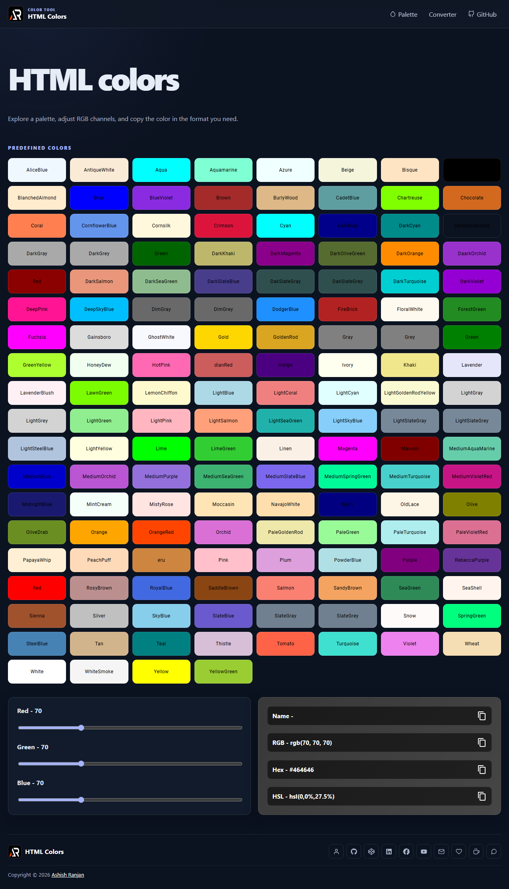

# HTML Colors



A responsive React color explorer and converter for browsing the standardized CSS named-color palette, adjusting RGB channels, and copying RGB, HEX, HSL, and exact color-name values.

## Features

- Browse all 148 CSS named colors, including spelling aliases such as gray/grey
- Adjust red, green, and blue channels with range controls
- Convert the selected color to RGB, HEX, HSL, and an exact matching CSS color name
- Copy each value directly to the clipboard with a confirmation toast
- Use keyboard-accessible color swatches, range controls, and copy buttons
- Fixed branded header with a small-screen menu
- Icon-only developer and support links in the footer
- Floating scroll-to-top control

## Tech Stack

React, Vite, Sass modules, Vitest, Testing Library, react-icons, and react-toastify.

## Run locally

```bash
npm install
npm run dev
```

Use Node.js 20.19+ or 22.12+. Vite serves the app under `/html-colors/` to match its GitHub Pages path.

Run the existing UI test with `npm test`.

## Deployment

```bash
npm run deploy
```

The deploy script builds the app and publishes `dist/` to the `gh-pages` branch.

Live app: [https://a2rp.github.io/html-colors/](https://a2rp.github.io/html-colors/)

## Links

- Portfolio: [https://www.ashishranjan.net](https://www.ashishranjan.net)
- GitHub: [https://github.com/a2rp](https://github.com/a2rp)
- CodePen: [https://codepen.io/ash1198](https://codepen.io/ash1198)
- LinkedIn: [https://www.linkedin.com/in/aashishranjan](https://www.linkedin.com/in/aashishranjan)
- Facebook: [https://www.facebook.com/theash.ashish/](https://www.facebook.com/theash.ashish/)
- YouTube: [https://www.youtube.com/@ashishranjan-ashz?sub_confirmation=1](https://www.youtube.com/@ashishranjan-ashz?sub_confirmation=1)
- Email: [ash.ranjan09@gmail.com](mailto:ash.ranjan09@gmail.com)

## Support

- Support: [https://a2rp-donation-page.netlify.app/](https://a2rp-donation-page.netlify.app/)
- Buy Me A Coffee: [https://buymeacoffee.com/a2rp](https://buymeacoffee.com/a2rp)
- Patreon: [https://patreon.com/a2rp](https://patreon.com/a2rp)
